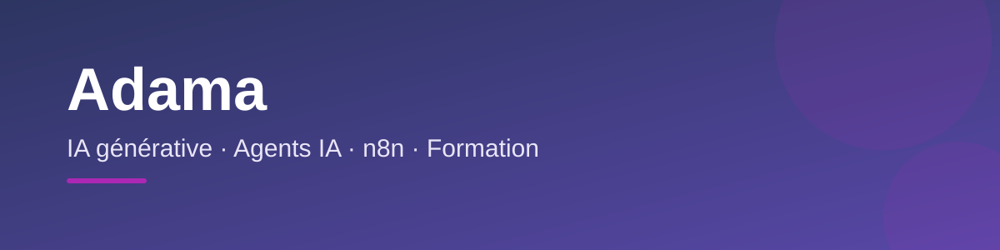

# Adama

*AI trainer and consultant: generative AI, AI agents, n8n automation, Microsoft 365 Copilot. Based in France.*

Formateur IA et consultant IA en Île-de-France : IA générative, agents IA, n8n, automatisation, Microsoft 365 Copilot et Power Platform.

**Consultant-formateur en IA générative, agents IA et automatisation des processus métiers**

Gérant de [Next Gen AI](https://next-gen-ai.fr) · Formateur indépendant depuis 2017 · Île-de-France et à distance

Diagnostiquer, construire, transmettre : trois verbes pour passer d'un usage ponctuel de l'IA à des processus qui tiennent.

## Trois offres

| Offre | Ce que je fais | Pour qui |
|---|---|---|
| **Conseil opérationnel IA** | Diagnostic des usages, cadrage, gouvernance, charte IA, AI Act et RGPD, coaching de dirigeants | Directions, CODIR, PME |
| **Automatisation et agents IA** | Processus automatisés, agents, intégrations d'API, applications métier low-code | Équipes métier, DSI, PME |
| **Formation et montée en compétences** | Parcours sur mesure, de l'acculturation à l'automatisation, en intra ou pour des organismes de formation | Organisations, organismes de formation |

## Domaines d'expertise

| Domaine | Dépôt | Formats |
|---|---|---|
| IA pour la direction et gouvernance | [ia-direction-gouvernance](https://github.com/Adam-s-tech/ia-direction-gouvernance) | Conseil, coaching CODIR, ateliers |
| Automatisation et agents IA | [automatisation-agents-ia](https://github.com/Adam-s-tech/automatisation-agents-ia) | Conseil, automatisation, formation n8n |
| Power Platform et applications métier | [power-platform-applications-metier](https://github.com/Adam-s-tech/power-platform-applications-metier) | Conseil, applications, formation |
| Data et décisionnel | [data-decisionnel](https://github.com/Adam-s-tech/data-decisionnel) | Conseil, tableaux de bord, formation |
| IA générative et adoption | [ia-generative-adoption](https://github.com/Adam-s-tech/ia-generative-adoption) | Conseil, acculturation, formation |

## Veille et labo

- [ocr-llm-miniature](https://github.com/Adam-s-tech/ocr-llm-miniature) : OCR et vision avec un LLM miniature, exécutés localement dans le navigateur.
- [Labo Adam AI](https://lab.adamai.fr) : analyses courtes et non techniques sur l'IA générative.

## Ce que je fais

J'aide les équipes métier à passer d'un usage ponctuel de l'IA à des automatisations et des agents qui tournent vraiment : cadrage du processus, construction, tests, puis formation des équipes qui vont les faire vivre.

- **Automatisation et agents IA** : n8n auto-hébergé, agents avec outils, intégration d'API REST et JSON, webhooks
- **IA générative en entreprise** : ChatGPT, Claude, Gemini, Mistral, Copilot, prompt et context engineering, évaluation des résultats
- **Écosystème Microsoft** : Microsoft 365 Copilot, Copilot Studio, Power Automate, Power Apps, SharePoint, Lists
- **Gouvernance** : charte IA, AI Act et RGPD, sécurisation des workflows et gestion des secrets

## Formation

Plus de 500 professionnels formés depuis 2017, en direct et pour des organismes de formation partenaires.

Sessions récentes : n8n (2 jours, équipes marketing et agence web), IA générative (5 jours, hybride), Microsoft 365 et Power Platform (5 jours).

Chaque formation s'appuie sur des supports testés avant la session et adaptés au public.

## Comment lire ce compte

La majorité des dépôts sont des **forks conservés pour ma veille technique** (agents IA, n8n, RAG, outils open source). Le dépôt d'origine et ses auteurs restent indiqués sur chaque fork.

Mes réalisations et démonstrations sont **épinglées** en haut de ce profil et publiées sur le [labo Adam AI](https://lab.adamai.fr).

## Outils du quotidien

*« La route est longue, mais la voie est libre. »*

## Me contacter

- Site : https://next-gen-ai.fr
- LinkedIn : https://www.linkedin.com/in/adam-ai-011540356
- YouTube : https://www.youtube.com/@AdamAi-v2i3e
- X : https://x.com/Adam_NextAi
